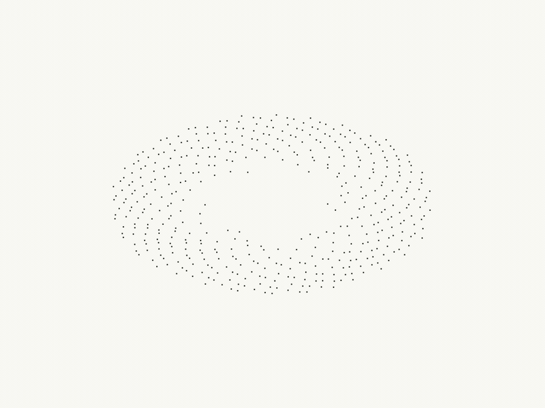

# Braino



A quiet place for passing thoughts and everyday tasks. Braino is a compact, local Mac app: press **Control–Space**, write something down, and carry on.

## Using Braino

- **One shortcut:** Control–Space brings Braino forward and focuses the task field. Press it again while Braino is active to hide it.
- **Quick capture:** Type in “add something” and press Return. Notes, categories and due dates are optional.
- **Just enough structure:** Today shows tasks planned for today or earlier. This week groups tasks into collapsible day cards, opening at Today. Someday holds tasks without a planned day.
- **Your preferred order:** Hover over a task and drag its grip. A yellow insertion gap shows where it will land, and surrounding tasks slide aside. In This week, you can also drag a task to another day.
- **Easy editing:** Click a title or expand a note to edit it inline. The three-dot menu opens notes, due date and category controls with Save/Cancel.
- **Done, then out of the way:** Check a task off to move it into Completed. This section stays hidden until you have completed something and defaults to the past week.
- **A little room for mistakes:** The on-screen Undo button restores your latest completion, deletion or move. Hover over a task to reveal Delete.
- **Stay within reach:** Use the pin to keep Braino above other windows. Closing its window leaves the app running in the menu bar; use Quit Braino to exit.

A due date is separate from a task’s planned day. Adding one does not move the task between Today, This week and Someday. In the weekly view, add directly under a day to plan it there; the main capture field in Today or This week adds to today.

For keyboard reordering, focus a task’s grip and press **Option–↑ / ↓** within its current list or day. If Control–Space is unavailable, use **Show Braino** in the menu bar.

## Install

Requires an **Apple Silicon Mac with macOS 14 or newer**. The current app version is **0.8.1**.

If you already have a Braino `.dmg` installer:

1. Quit any older copy of Braino.
2. Open the installer and drag Braino into Applications.
3. Open Braino from Applications.

Replacing the app keeps your saved tasks. This is a locally signed development build; it is not notarized for public distribution.

The installer is generated locally and is **not included in a source checkout**. To create it from this repository, follow the build instructions below.

## Your data

Tasks and categories stay on your Mac. There is no cloud sync or analytics, and the installed app works offline.

Files are saved in `~/Library/Application Support/Braino/`:

| File | Contents |
| --- | --- |
| `tasks.json` | Tasks, notes, order, planned days, due dates and completion history |
| `categories.json` | Named categories |

Quit Braino before manually backing up or changing these files. Browser-preview tasks are stored separately in that browser and do not sync with the Mac app.

**Agent integration is planned, but is not implemented yet.**

## Build from source

Requires Apple Command Line Tools, Python 3 and Node.js. The build uses the macOS tools already on your machine; there are no runtime packages to install.

```sh
git clone https://github.com/hazelvillena/braino.git
cd braino
./scripts/test.sh
./build.sh
open Braino.app
```

To create an installer:

```sh
./package.sh
```

This builds the app and writes `dist/Braino.dmg`.

## Try the browser preview

From the repository folder, run:

```sh
node preview/server.mjs
```

Open [localhost:4317](http://localhost:4317). The preview uses the same interface as the app, with separate demo data. The global shortcut and keep-on-top behavior require the Mac app; in the browser, Control–Space only focuses capture within the page.

## Development notes

The interface lives in `preview/`. The build bundles it for offline use in WKWebView. AppKit supplies the native window, menu bar, global shortcut, pinning and standard Edit menu, including Cmd+A, Cut, Copy and Paste.

The window starts at its minimum width of 410 points and adjusts its height to fit the content. Long lists scroll inside it.

`./scripts/test.sh` checks task planning and history filters, persistent ordering, move/delete Undo, native storage and migration, categories, the desktop data bridge and bundled-interface parity.

The original transparent brain artwork is `Assets/BrainoMark.png`. `scripts/BrandAssets.swift` generates the app, menu-bar and header assets. The README animation is a motion illustration rather than a recording of the app.

See [the design system](docs/design-system.md) for the visual direction and interaction notes.
