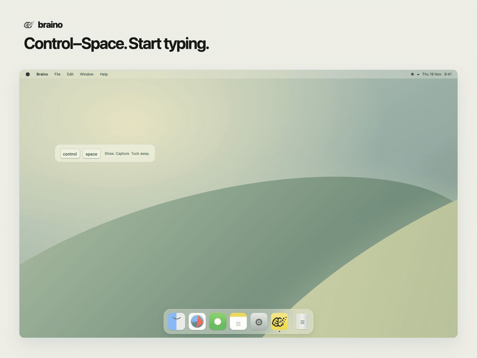

# Product intent

## One shortcut. Start typing.

Braino is a compact local Mac app for capturing small tasks with as little setup as possible. Press Control–Space, type a thought, press Return, and tuck the window away with the same shortcut.

## The problem is the way in

People already have places to write things down: task apps, notes, documents and sticky notes. Braino starts from a narrower question: how little interaction can sit between a passing thought and a saved task?

Opening an app, finding a list or deciding how to organize something can interrupt a small capture moment. This is the motivation for the project, not a claim that other tools are universally difficult or that everyone needs another app.

Braino borrows the immediacy of a sticky note and makes it reachable by a global shortcut. It aims to complement existing workflows rather than replace a full project-management system.

## Design decisions

| Intent | Current behavior |
| --- | --- |
| Make the way in short | Control–Space brings the app forward and focuses capture. |
| Let writing come before organizing | A title is enough to save a task. Notes, due dates and categories are optional. |
| Keep the interruption small | The window starts at 410 points wide, with internal scrolling for longer lists. |
| Add structure when useful | Today, This week and Someday provide lightweight planning. Weekly days support inline capture. |
| Make the way out short | The same shortcut hides Braino while it is active. Closing the window keeps menu-bar access available. |
| Keep everyday actions direct | Titles and notes edit inline; tasks can be reordered, completed or deleted with visible feedback and Undo. |
| Avoid an account or workspace setup step | The installed app uses local files, works offline and has no sign-in flow. |

## Positioning and voice

Lead with access, capture and optional organization. Useful phrases:

- “One shortcut. Start typing.”
- “Small by design. Easy to reach.”
- “A compact Mac app for small tasks.”
- “A sticky-note habit, with a keyboard shortcut.”

Do not frame the problem as “nowhere to put it.” People already have tools. Avoid broad claims that task apps are too complicated, or that Braino is frictionless for everyone. “Designed to reduce friction” describes the intent more accurately.

Keep interface copy short and practical. Portfolio headlines explain the idea outside the app; they do not need to become onboarding steps or extra interface text.

## Scope and evidence

The app implements capture, planning views, categories, optional due dates, notes, history, ordering and local persistence. Agent integration is planned, not available.

The shortcut, focused input and optional metadata are implemented behaviors. Faster capture, less interruption and subjective ease are design goals, not measured usability results. Do not invent time-saved claims, adoption figures or comparative benchmarks.

Useful future checks: can someone add a first task without explanation, find the capture field after opening, skip optional details, and get back to their previous work? Observe where they hesitate before adding more features.

## Portfolio materials

The current kit follows this sequence:

1. The capture moment: writing it down should be easy.
2. The response: one shortcut, then typing.
3. The platform: a compact Mac app with optional structure.
4. A single desktop show/hide loop, without a duplicate desktop still.
5. Positioning: “Keep your workflow. Add a shortcut,” shown as a capture bar alongside existing tools.

The gallery cover is an abstract pixel animation. The desktop demo below is a staged motion illustration using the real UI and sample tasks; it is not a recording or a claim that the native app uses these exact presentation effects.

Use the static [desktop poster](media/braino-desktop.jpg) for reduced motion. Website copy and asset guidance live in [the portfolio handoff](portfolio/README.md).
